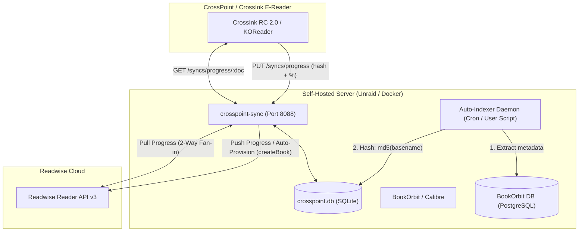

# CrossPoint $\leftrightarrow$ Readwise Reader 2-Way Sync

Seamless, bidirectional reading progress synchronization between **CrossPoint / CrossInk (KOReader)** e-readers and **Readwise Reader**, with automated library indexing and on-the-fly book provisioning.

---

## Overview

When using a CrossPoint or CrossInk device (e.g. CrossInk X4 running CrossInk RC 2.0 or KOReader) backed by a self-hosted [`crosspoint-sync`](https://github.com/crosspoint-reader/crosspoint-sync) server:
- Reading on the e-reader automatically updates your reading progress in Readwise Reader, instantly moving books into **"Currently Reading"**.
- Reading in Readwise Reader automatically pulls forward your position when you pick up the e-reader.
- Books opened first on the e-reader—even if not yet in Readwise—are automatically indexed, provisioned, and matched.

---

## Architecture



---

## The Challenges Solved

### 1. Hash-Only Device Payloads
CrossInk and KOReader in standard sync mode send only a 32-character MD5 hash of the book's filename (`md5(path.basename(file))`), a progress string, and percentage. They **do not send book metadata** (`title` and `author` are omitted).
- **Impact**: Without metadata in `documents`, `crosspoint-sync` marked incoming books as `title: null`, failing candidate matching and dropping fan-out synchronization to Readwise.
- **Fix**: The **Library Auto-Indexer** pre-computes and syncs the exact filename hashes from BookOrbit / disk into `crosspoint.db`. When an e-reader syncs, the title and author are already known.

### 2. Readwise 20 req/min Rate Limiting
Readwise Reader enforces a strict quota of 20 requests/minute per API token. Rapid queries across library candidate pools quickly trigger `429 Too Many Requests`.
- **Fix**: Implemented a 10-minute in-memory candidate pool cache with automatic backoff and cooldown tracking (`READWISE_RATE_COOLDOWN_MS`).

### 3. Timestamp Inversion on Cold Starts
When a user has read 30% of a book in Readwise Reader and then opens the book on their e-reader for the first time (at 0%), the device's open timestamp (now) is newer than Readwise's previous update timestamp (yesterday).
- **Fix**: In `pullProgress`, if Readwise's percentage is ahead of the device's recorded progress (`pct > currentPct + 0.005`), `updatedAtMs` dynamically takes precedence (`Date.now()`), allowing Readwise's position to pull forward onto the device.

### 4. Books Opened First on Device
If a book read on the e-reader was not yet imported into Readwise Reader, matching previously failed.
- **Fix**: Implemented `createBook` in `readwise-reader.js`. If candidate matching yields no match, the connector automatically saves the book to Readwise Reader via `POST https://readwise.io/api/v3/save/` with `category: 'epub'`, acquiring a fresh document ID and immediately applying progress.

---

## Repository Structure

```
├── connectors/
│   ├── readwise-reader.js   # 2-way sync connector with caching, auto-matching & createBook
│   └── refresh.js           # Patched on-demand fan-in refresh handler
├── scripts/
│   ├── sync_library.sh      # Extracts BookOrbit books & populates crosspoint.db hashes
│   └── install_user_script.sh # Automates 15-minute cron/User Scripts installation
├── docker-compose.yml       # Production-ready crosspoint-sync deployment
├── .env.example             # Configuration template
├── LICENSE
└── README.md
```

---

## Installation & Setup

### 1. Configure Environment
Copy `.env.example` to `.env` and fill in your values:
```bash
cp .env.example .env
```
Generate an encryption key:
```bash
openssl rand -hex 32
```
Set `TOKEN_ENC_KEY` in `.env`.

### 2. Deploy `crosspoint-sync`
Using Docker Compose:
```bash
docker compose up -d
```
The custom connector files are bind-mounted read-only over `/app/dist/connectors/readwise-reader.js` and `/app/dist/connectors/refresh.js`.

### 3. Connect Readwise Reader
1. Open the CrossPoint Sync web dashboard: `http://<your-server-ip>:8088`
2. Log in with your sync account.
3. Under **Integrations**, connect **Readwise Reader** using your API Token (obtained from [readwise.io/access_token](https://readwise.io/access_token)).

### 4. Run Library Auto-Indexer
Run the library indexer to populate `documents` with your existing library:
```bash
bash scripts/sync_library.sh
```

### 5. Automate Recurring Indexing
#### On Unraid (Recommended):
Run the installer script:
```bash
bash scripts/install_user_script.sh
```
This adds **`Sync BookOrbit to CrossPoint`** under **Settings $\rightarrow$ User Scripts** running every 15 minutes.

#### On Standard Linux / Cron:
Add to your crontab:
```bash
*/15 * * * * /path/to/crosspoint-readwise-sync/scripts/sync_library.sh > /dev/null 2>&1
```

---

## Device Setup (CrossInk / KOReader)

1. On your CrossPoint or CrossInk device, go to **Settings $\rightarrow$ Sync / KOReader Sync**.
2. Set Server URL: `http://<your-server-ip>:8088` (or your reverse-proxy URL, e.g. `https://sync.yourdomain.com`).
3. Enter your username and auth key.
4. In **Settings $\rightarrow$ Connectivity / Sync**, enable:
   - **Sync on Document Close / Exit**
   - **Sync on Sleep / Suspend**

---

## Verification

To verify that reading progress is flowing correctly:
1. Open any book on your CrossInk device and turn a few pages.
2. Close the document or put the device to sleep.
3. Refresh your [Readwise Reader](https://read.readwise.io) shelf:
   - The book will appear immediately under **"Currently Reading"** with the exact percentage synced.

---

## License

MIT License. See [LICENSE](LICENSE) for details.
